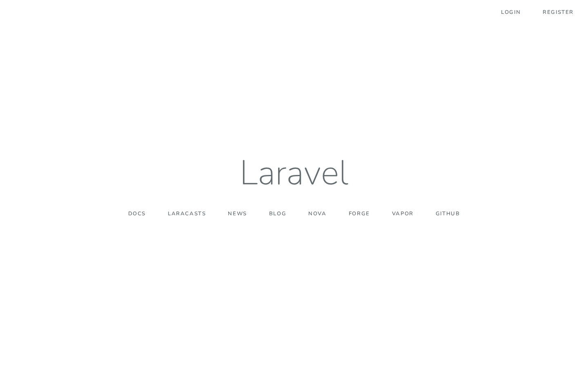
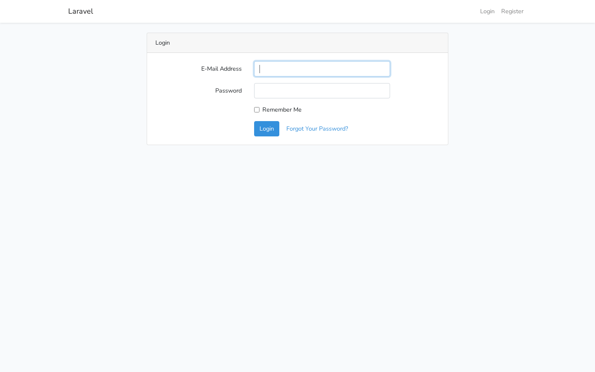
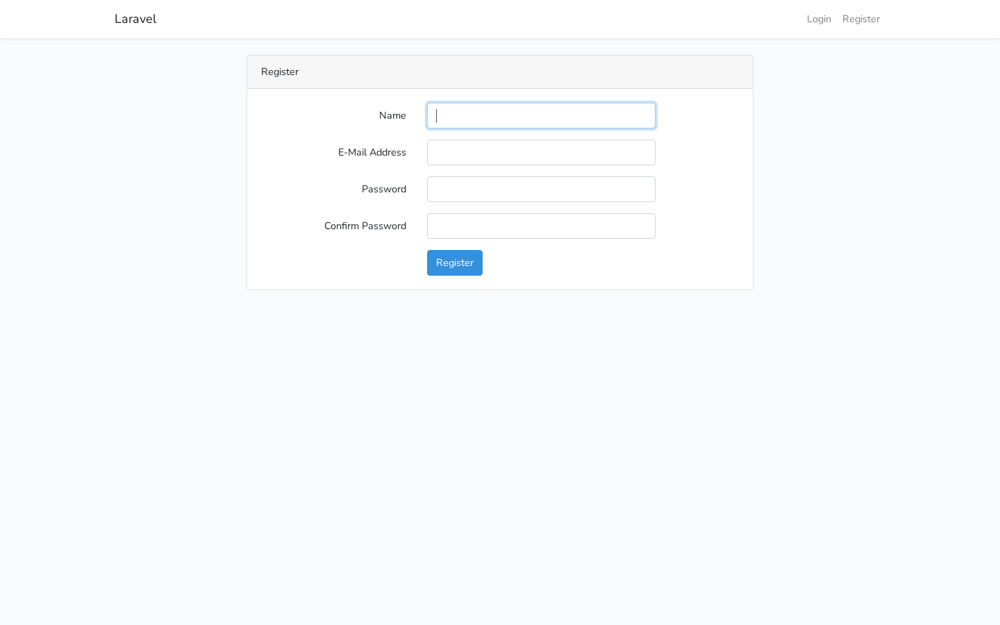

# Trilu

Trilu is a task-management backend built around boards, ordered lists, and task
cards. A registered user creates a board, adds other users to it as members, and
then organizes work by adding lists to the board and cards to each list,
reordering them and moving cards between lists as priorities change. Its audience
is an external client — a mobile app or single-page frontend — that consumes a
JSON API and authenticates with a bearer token.

Trilu has no web interface of its own. The three screenshots in this README are
the stock scaffolding shipped with the underlying PHP framework: its default
welcome, login, and registration pages, captured from this repository. They are
not the Trilu product UI. Everything the product actually does happens at
`/api/v1/*`, which returns JSON only.



The framework's out-of-the-box welcome page. Trilu itself has no screen like
this — its surface is an API.

## What you can do

- Register an account and receive a bearer token through `POST /api/v1/auth/register`, so a new user can start calling the API.
- Log in with a username and password through `POST /api/v1/auth/login` to get a token, and revoke it with `GET /api/v1/auth/logout`.
- Create a board you own, list the boards you can see, and rename or delete a board through `/api/v1/board`.
- Add a member to a board by username, or remove an existing member, through the board's `/member` endpoints.
- Add an ordered list to a board, then rename or delete it through the board's `/list` endpoints.
- Add a task card to a list and edit or delete it through the nested `/card` endpoints.
- Reorder lists left or right and cards up or down, and move a card from one list to another, so the board tracks changing work.

The login and registration screens below are Laravel's stock auth views from the
framework scaffold. They are here only to document what the repository renders;
the real Trilu auth flow is the token-returning API calls above, and these forms
do not work against the repository's current database schema.



Laravel's default login form — an email-and-password card. Trilu's API logs in by
username, not email, and returns a bearer token rather than a session.



Laravel's default registration form, with name, email, and password fields. It is
framework scaffolding, not a Trilu screen.

## How it works

Trilu is a Laravel JSON API: nginx serves `public/` and hands PHP requests to
PHP-FPM over a Unix socket. Access is controlled by Passport bearer tokens plus
three board-aware middleware — `member`, `boardmember`, and `cardmember` — that
verify a user is allowed to reach the specific board, list, or card. Board, list,
and card resources are nested under `/api/v1/board/{board_id}`, so authorization
follows the ownership chain from a board down to its cards.

## Running it

```
git clone https://github.com/Richie-Z/Backend-Trilu.git
cd Backend-Trilu
composer install
cp .env.example .env
php artisan key:generate
```

Create a database and set `DB_CONNECTION`, `DB_HOST`, `DB_DATABASE`,
`DB_USERNAME`, and `DB_PASSWORD` in `.env` (the code defaults to MySQL; the
workspace uses PostgreSQL). Then:

```
php artisan migrate
php artisan serve
```

Note that `migrate` alone will not produce a working Trilu database — see
Limitations.

## Limitations

- Running `php artisan migrate` creates only `users` and `products`. The tables the API actually uses — boards, board members, lists, and cards — are defined in `database/migrations/temp/`, which Laravel does not load, so those endpoints fail against a fresh database.
- Because of that mismatch, registration and login are expected to fail against the migrated schema; the screenshots show forms that render but were not exercised end to end.
- Passport's signing keys and personal-access client are not committed and `passport:install` has not been run, so token issuing would fail on first use until someone provisions them.
- Committed bearer tokens in `Trilu.postman_collection.json` (lines 81, 116 and others) should be treated as exposed and revoked.
- The runtime is PHP 7.2, which is end-of-life and receives no security fixes.
- There is no global auth or API-key middleware, so a request to `/` returns 200 and unauthenticated API calls reach their routes before `auth:api` rejects them.

Developer notes, exact versions, the full data model, and operational risks are
in [TECHNICAL.md](TECHNICAL.md).
